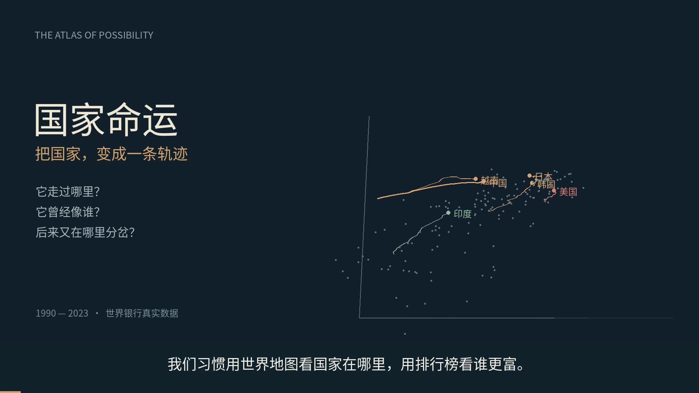

# 国家命运 · 发展轨迹实验室

**在线体验：** https://wanglu2016.github.io/nation-fates/

**使用讲解视频（5分05秒）：** https://wanglu2016.github.io/nation-fates/guide.html

点开网页即可操作，无需登录、下载或安装。项目源码、真实数据与中文使用视频均保存在本仓库。

[使用视频（MP4，约5分05秒）](nation-fates-guide.mp4) · [同步字幕（SRT）](nation-fates-guide.srt)



用世界银行 WDI 的真实数据，把国家与经济体的年度状态绘成固定坐标中的三维路径。中文界面，静态站点，无第三方前端依赖。

## 体验

- 发展坐标：收入（对数）、寿命、城市化三轴；可拖动旋转、滚轮缩放、点击国家，也可用键盘方向键及 +/- 操作。
- 六维投影：六项标准化指标的固定全期 PCA，前三轴保留约 91.4% 方差。
- 时间轴：1990—2023，年度播放，轨迹开关与地区筛选。
- 国家档案：六项数值、历史趋势、同年最接近的三个国家。
- 跨时比较：两国各自年份的逐项比较；在相隔至少8年的其他经济体中匹配历史状态。
- 命运分岔：任选两个历史起点，用六张同尺度双折线比较各自后续最多十年，并展示原始数值。
- 三个探索入口：东亚、拉美、人口转变。

## 数据与口径

数据源：[World Development Indicators](https://databank.worldbank.org/source/world-development-indicators)，[World Bank API](https://datahelpdesk.worldbank.org/knowledgebase/articles/889392)。快照日期、源数据更新日期及完整口径均在 `data.json` 中；页面“资料与方法”提供每项指标链接及数据快照下载。

| 指标 | WDI 代码 |
| --- | --- |
| 人均GDP，购买力平价，2021年不变国际元 | NY.GDP.PCAP.PP.KD |
| 出生时预期寿命 | SP.DYN.LE00.IN |
| 城市人口比例 | SP.URB.TOTL.IN.ZS |
| 总和生育率 | SP.DYN.TFRT.IN |
| 65岁及以上人口占比 | SP.POP.65UP.TO.ZS |
| 工业增加值（含建筑业）占GDP比例 | NV.IND.TOTL.ZS |

149个国家与经济体，34年，4737个六项齐全状态。取2023年人口至少200万的非汇总经济体，另选10个较小经济体，全期须有至少5个完整状态。人口只作样本筛选，不计入距离。

仅对两侧观测相隔不超过3年的内部短缺口作线性插值；本快照补1个指标值。无外推。六维投影与距离要求所有指标齐全；三轴视图只要求相应三个指标齐全。缺失年度轨迹断开。

收入先取自然对数，再以所有完整国家年份样本的全期均值和总体标准差标准化。所有年份共享一个PCA基底。相似度使用原六维的等权标准化欧氏距离除以根号6，不使用屏幕距离。每个国家在跨时搜索中仅保留一个最近年份。相似状态不保证未来相同，也不能识别因果。

## 开发与复现

仓库根目录可由任何静态网页服务器托管，数据和视频随项目一起加载。交互入口为 `index.html`，视频播放页为 `guide.html`，页面底部也有使用视频入口。

在本地运行：

```sh
python -m http.server 8000
```

然后打开 `http://localhost:8000/`。GitHub Pages 可从 `main` 分支的根目录发布；是否可启用以仓库权限及 GitHub 页面设置为准。

更新数据需要 Python 3 和 NumPy：

```sh
python build_data.py
```

原始响应缓存于 `cache/`（不纳入版本控制）。删除该目录后重建，可重新下载源数据。WDI 数据会修订，重新获取的结果未必与此快照完全相同。

## 随仓库保存的视频

`nation-fates-guide.mp4`：1080p，中文男声旁白，已烧录74条同步字幕，含13个章节。`nation-fates-guide.srt` 可供后期编辑。

视频采用与网页相同的 WDI 快照，包含实际界面操作示范、动态发展轨迹与六项后续趋势对比。
